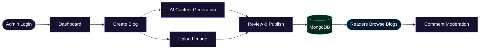

<a id="top"></a>

<div align="center">



<br/>


<br/>

**An AI-powered blogging platform built for effortless content creation and modern blog management.**

<br/>

<a href="https://quick-blog-client-delta-two.vercel.app/">

</a>
<a href="https://gitdiagram.com/chanu2005-wq/ai_powered_blog">

</a>

<br/><br/>


<br/><br/>


<br/>

`IDEA` &nbsp; ◆ &nbsp; `GENERATE` &nbsp; ◆ &nbsp; `PUBLISH` &nbsp; ◆ &nbsp; `INSPIRE`

<br/>

[About](#-about-the-project) · [Features](#-core-features) · [Architecture](#-system-architecture) · [Tech Stack](#-technology-stack) · [Setup](#-getting-started) · [Deployment](#-live-deployment) · [Roadmap](#-future-enhancements)

</div>

---

<a id="-about-the-project"></a>

## 🌌 About the Project

**AI-Powered Blog** is a full-stack blogging application designed to streamline content creation, publishing, and blog administration with AI-assisted writing capabilities.

The platform combines a reader-friendly experience with a dedicated admin workspace for managing articles, moderating comments, uploading images, and generating AI-assisted blog content.

<details open>
<summary><strong>💎 What makes Quick Blog special?</strong></summary>

<br/>

| Capability | Description |
|---|---|
| 🤖 AI-assisted writing | Generate blog content using an integrated AI service |
| 📝 Blog management | Create, edit, publish, and delete blog posts |
| 🔐 Admin workspace | Protected administrative operations |
| 🖼️ Image hosting | Upload and serve blog images through ImageKit |
| 💾 Persistent storage | Store blog and comment data in MongoDB |
| ☁️ Cloud deployment | Deploy the frontend and backend independently |

</details>

### ✍️ Publishing Workflow



<sub>Conceptual workflow based on the documented project functionality.</sub>

---

<a id="-system-architecture"></a>

## 🏗️ System Architecture

<div align="center">

**FRONTEND → BACKEND API → DATABASE & EXTERNAL SERVICES**

<a href="https://gitdiagram.com/chanu2005-wq/ai_powered_blog">

</a>

[**Explore the interactive architecture →**](https://gitdiagram.com/chanu2005-wq/ai_powered_blog)

</div>

### Architecture at a glance

<details>
<summary><strong>🔵 Frontend — Reader Experience</strong></summary>

- Browse published blogs.
- View individual articles.
- Submit comments.
- Navigate the blogging interface.

</details>

<details>
<summary><strong>🟣 Admin Workspace</strong></summary>

- Authenticate administrators.
- Access the dashboard.
- Create and manage blog posts.
- Moderate comments.

</details>

<details>
<summary><strong>🟢 Backend Services</strong></summary>

- Express.js API.
- Blog and admin controllers.
- AI content-generation integration.
- Authentication and token verification.

</details>

<details>
<summary><strong>🟠 Data & Integrations</strong></summary>

- MongoDB for application data.
- ImageKit for image hosting.
- An integrated AI provider for content generation.
- Vercel and Render for deployment.

</details>

---

<a id="-core-features"></a>

## ✨ Core Features

<details open>
<summary><strong>🤖 AI-Powered Content Generation</strong></summary>

Create blog content using the integrated AI service to support the writing workflow.

</details>

<details>
<summary><strong>📝 Blog Management System</strong></summary>

Manage blog posts through the administrative interface, including creation, editing, publishing, and deletion.

</details>

<details>
<summary><strong>🔐 Authentication & Authorization</strong></summary>

Use the application's authentication and token-verification flow to protect administrative operations.

</details>

<details>
<summary><strong>🖼️ ImageKit Integration</strong></summary>

Upload blog images and deliver them through an external image-hosting service.

</details>

<details>
<summary><strong>💬 Comment Management</strong></summary>

Review and moderate reader comments through the admin workspace.

</details>

<details>
<summary><strong>📚 Blog Discovery</strong></summary>

Browse published content and read individual blog posts through a dedicated reader interface.

</details>

---

<a id="-technology-stack"></a>

## ⚙️ Technology Stack

<div align="center">


</div>

| Layer | Technology | Purpose |
|---|---|---|
| Frontend | React, Vite | User interface and development tooling |
| Backend | Node.js, Express.js | API and server-side logic |
| Database | MongoDB Atlas | Persistent application data |
| Image Hosting | ImageKit | Image uploads and delivery |
| AI Integration | Configured AI provider | AI-assisted content generation |
| Frontend Hosting | Vercel | Frontend deployment |
| Backend Hosting | Render | Backend deployment |
| Language | JavaScript | Application development |

---

<a id="-project-structure"></a>

## 📂 Project Structure

```text
## 📂 Project Structure

```text
AI_powered_blog/
│
├── client/
│   ├── public/
│   ├── src/
│   │   ├── assets/
│   │   ├── components/
│   │   ├── pages/
│   │   │   ├── Home.jsx
│   │   │   ├── Blog.jsx
│   │   │   ├── BlogList.jsx
│   │   │   └── admin/
│   │   └── context/
│   │       └── app-context.jsx
│   └── package.json
│
├── server/
│   ├── configs/
│   ├── controllers/
│   ├── models/
│   ├── routes/
│   ├── middleware/
│   ├── server.js
│   └── package.json
│
├── diagram.png
└── README.md
```


```

<sub>This is an illustrative structure based on the supplied documentation. Verify directory and filename details against your repository.</sub>

---

<a id="-getting-started"></a>

## 🚀 Getting Started

Run the frontend and backend locally to develop and test the application.

### Prerequisites

- [Node.js](https://nodejs.org/)
- npm
- [MongoDB Atlas](https://www.mongodb.com/atlas) or a compatible MongoDB instance
- [ImageKit](https://imagekit.io/) credentials
- Credentials for the AI provider configured by the application

### 01. Clone the repository

```bash
git clone https://github.com/chanu2005-wq/AI_powered_blog.git
cd AI_powered_blog
```

### 02. Configure and run the backend

```bash
cd server
npm install
```

Create your environment file if an example file is available:

```bash
cp .env.example .env
```

Configure the environment variables required by the backend, including the database connection, admin authentication, ImageKit, and AI integration.

Start the backend:

```bash
npm start
```

### 03. Configure and run the frontend

Open a second terminal:

```bash
cd client
npm install
```

If your project provides a frontend environment example:

```bash
cp .env.example .env
```

Configure the frontend API URL according to your application settings.

Start the frontend:

```bash
npm run dev
```

Open the local development URL shown in the terminal.

### 🔑 Environment Configuration

Configure the variable names expected by your actual source code for:

- MongoDB connection URI.
- Administrator authentication.
- ImageKit credentials and URL endpoint.
- AI provider API key.
- Frontend API base URL.
- Frontend origin and CORS settings.

> [!CAUTION]
> Never commit real credentials, production database URIs, passwords, or private API keys to GitHub. Keep sensitive values in environment variables.

---

<a id="-live-deployment"></a>

## 🌐 Live Deployment

<div align="center">

<a href="https://quick-blog-client-delta-two.vercel.app/">

</a>

<a href="https://ai-powered-blog-534w.onrender.com/">

</a>

<a href="https://www.mongodb.com/atlas">

</a>

</div>

| Resource | Link |
|---|---|
| 🌐 Live Website | [Open Quick Blog](https://quick-blog-client-delta-two.vercel.app/) |
| ⚙️ Backend Host | [Render Service](https://ai-powered-blog-534w.onrender.com/) |
| 🏗️ Architecture | [GitDiagram](https://gitdiagram.com/chanu2005-wq/ai_powered_blog) |
| 💻 Source Code | [GitHub Repository](https://github.com/chanu2005-wq/AI_powered_blog) |

<sub>Deployment URLs are retained from the supplied README. Their current availability has not been independently verified.</sub>

---

<a id="-future-enhancements"></a>

## 🔮 Future Enhancements

The following are **suggestions for future development**, not claims about existing functionality.

- [ ] 🔎 Full-text blog search, tags, and categories.
- [ ] ✍️ Rich-text editing experience.
- [ ] 🧠 AI-generated titles and article summaries.
- [ ] 📊 Expanded blog analytics.
- [ ] 🔍 Search engine optimization tools.
- [ ] 🎯 Related-article recommendations.

---

## 🔒 Security Best Practices

- Store sensitive configuration in environment variables.
- Protect administrative endpoints with server-side authorization.
- Validate incoming requests.
- Restrict cross-origin requests to trusted frontend origins.
- Use secure production deployment settings.
- Never expose API keys in frontend code or public repositories.

---

## 🤝 Contributing

Contributions, suggestions, and bug reports are welcome.

1. Fork the repository.
2. Create a feature branch.
3. Implement and test your changes.
4. Commit your changes with a clear message.
5. Open a pull request describing your improvements.

---

## 👨‍💻 Author

<div align="center">

### Chanukya Chandra

Full-Stack Development · AI Integration

<a href="https://github.com/chanu2005-wq">

</a>

<br/><br/>

**Built with the MERN ecosystem. Enhanced with AI. Designed for better blogging.**

If you find this project useful, consider giving it a ⭐ on GitHub.

<br/>

[⬆ Back to Top](#top)


</div>
